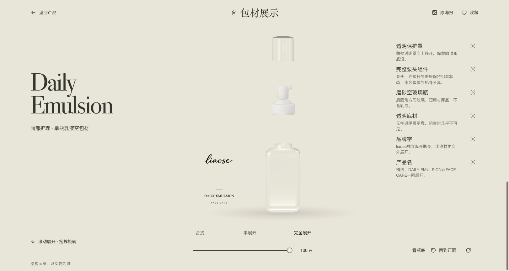

# 海报到交互包材库

**提供产品海报，选择视觉风格，让 AI 使用现成网页底座与 3D 流程，搭建自己的独立包材库。**

适合不会写代码、不会 Blender 的使用者：你负责提供海报和确认外观，AI 负责安装环境、整理图片、制作展示级模型、接入页面与检查。该仓库包含可运行源码、Skill、脚本和样例；使用 AI 执行 Skill 才能完成新产品制作，它不是仅凭图片自动精确还原所有瓶型的软件。



## 零基础：把这段交给 AI

先下载或克隆整个仓库，再把本地仓库目录与海报目录提供给能够操作本地文件的 Codex：

> 请读取这个仓库中的 `packaging-library/SKILL.md`，使用现成底座为我创建独立包材库。海报使用我提供的文件夹，风格选择“自然温润”。请由你完成环境准备、素材导入、产品识别、3D 制作、接入与验收，不要让我写代码或填写技术配置。产品身份或关键外观无法判断时集中问我。先交付本地可运行版本，保留原海报和模型源文件。

风格可选 **自然温润 / 清透简洁 / 鲜明活泼**。这三种预设共用布局，调整配色与展示气质。具体产品的瓶型、包装颜色、品牌文字仍以海报为准。

完整操作说明见 [零基础指南](docs/beginner-guide.html)（下载后用浏览器打开）和 [工作流](packaging-library/references/workflow.md)。需要长期使用时，让 AI 将整个 `packaging-library` 目录安装为个人 Skill；保持 `assets`、`scripts`、`references` 一起复制。

## 已包含什么

| 部分 | 内容 |
|---|---|
| 网页 | 首页轮播、浏览、搜索、分类/风格筛选、收藏、原图查看与下载、窄屏布局 |
| 3D 查看器 | 延迟加载、拖拽旋转、合拢/半展/全展、底部视角、回零、失败重试和原图回退 |
| 新项目导入 | 保留原图、生成预览、分配稳定 ID、写入产品数据；拒绝覆盖已有目录 |
| 建模起点 | 圆罐、泵瓶、滴管瓶配方，导出 GLB、`.blend` 与部件配置 |
| 模型接入 | 核对模型节点、海报 ID、贴图和展开映射，失败时恢复配置 |
| 示例 | 三款现有产品；另附三种中性空白配方及其源文件 |
| 自动检查 | 前端测试、图片与 GLB 检查、导入与失败保护测试、构建工作流 |

`new_project.py` 只完成海报导入，不执行 OCR、抠图或海报识别建模。含 3D 的任务由 Skill 指导 AI 继续制作与校准；基础配方输出为草稿，只有对照原图检查后才能交付。

## 开发者快速运行示例

环境：Node.js 24、npm；导入和检查脚本使用 Python 3.12 与 Pillow；生成模型另需 Blender 4.5 系列。

```sh
cd packaging-library/assets/starter
npm ci
npm run dev
```

打开终端显示的本地地址（默认 `http://127.0.0.1:8897`）。GitHub 源码不提交 `node_modules` 和 `dist`；所有图片、GLB、前端源码与锁文件都在仓库中，不依赖原作者的本机目录。

## 用自己的海报新建项目

在仓库根目录安装 Python 依赖，然后运行导入。下列路径请替换为实际位置；普通使用者可以让 AI 执行。

```sh
python -m pip install -r requirements.txt
python packaging-library/scripts/new_project.py --posters /path/to/posters --out /path/to/new-library --style natural --name "我的包材库"
```

在新项目目录执行 `npm ci` 和 `npm run dev`。新目录里使用你的海报，原示例产品与模型不会一起保留。原图字节保留；相同图片内容去重。名称、类别和产品描述由 AI 根据原图校正。

制作 3D 参考 [建模流程](packaging-library/references/modeling.md)。例如，复制配方到项目模型源目录，改为对应产品 ID 并按海报校准：

```sh
blender --background --python-exit-code 1 --python packaging-library/scripts/build_model.py -- /path/to/spec.json /path/to/new-model-version
python packaging-library/scripts/attach_model.py /path/to/new-library /path/to/new-model-version
```

保留海报、spec、贴图、`.blend`、GLB 和配置。新产品不能绑定旧样例的模型冒充完成。

## 本地验证

在仓库根目录：

```sh
python -m pip install -r requirements.txt
python packaging-library/scripts/test_pipeline.py -v
python packaging-library/scripts/check_project.py packaging-library/assets/starter
```

在 `packaging-library/assets/starter`：

```sh
npm ci
npm test
npm run build
```

`.github/workflows/validate.yml` 在 push、PR 或手动触发时执行这些检查。它只验证和构建，不发布网页、不写业务数据库。工作流使用锁文件进行安装，做法参考 [GitHub 官方 Node.js 构建与测试说明](https://docs.github.com/en/actions/tutorials/build-and-test-code/nodejs)。

浏览器的逐款视觉验收仍需人工/AI 对照原图，参见 [验收清单](packaging-library/references/qa-delivery.md)。历史套件记录在 [初始验证报告](docs/initial-kit-validation.json)，仓库准备结果另见 [仓库验证报告](docs/repository-validation.json)；历史报告不代表当前 GitHub Actions 已运行。

## 目录

```text
README.md
requirements.txt
.github/workflows/validate.yml
packaging-library/
  SKILL.md
  agents/openai.yaml
  scripts/
  references/
  assets/
    starter/          网页源码、样例、前端锁文件
    recipes/          三种基础配方
    recipe-examples/  中性配方生成的可编辑示例
docs/                新手指南、截图和验证记录
```

## 复用目标与范围

目标是减少至少 70% 的重复人工工作。**尚未通过真实新手对照计时证明这一比例。** 页面和交互可以复用；异形瓶、复杂透明材质和曲面标签仍需要逐款工作。计时方式见 [人工工时测量](packaging-library/references/effort-measurement.md)。

单张海报支持展示级外观建模，不能确认真实毫米尺寸、背面或隐藏泵芯。物理制造需要实测资料。本静态项目也没有私有访问控制；需要账户系统时另行接入服务端。

## 代码与示例素材

第三方组件保留在 [第三方许可](THIRD_PARTY_NOTICES.txt) 中列出的条款与版权说明。原有品牌、产品海报及带品牌模型是展示样例，不能据此声称拥有对应品牌资产；新项目请使用自己的素材。

框架自有代码、文档与中性建模配方采用 [MIT 许可](LICENSE)，可以下载、修改和复用。第三方组件和带品牌示例素材的具体范围见 [ASSETS.md](ASSETS.md)。
