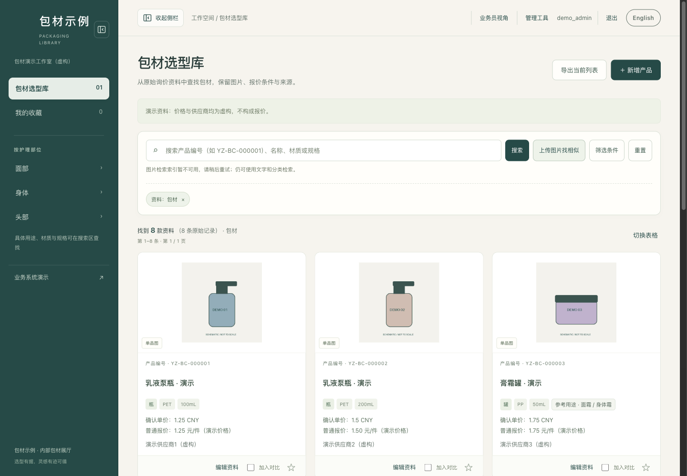

# 包材业务端：员工选型与管理员维护

从现有包材系统提取的独立业务端，包含真实的登录、权限和数据保存，以及完全虚构的演示资料。可与仓库里的展示首页、海报浏览和 3D 前端分别运行。

**公开的是代码和演示数据。没有原业务库、真实供应商/客户资料、报价记录、账号、会话或部署密钥。**



本次验证记录：[独立业务端验证](../docs/business-validation.json)。

## 不会写代码：交给 AI

> 请读取这个仓库的 `packaging-library/SKILL.md` 和 `business/README.md`，在我的电脑上搭建独立包材业务端。请你安装环境、启动演示，并告诉我如何用本机生成的员工和管理员账号登录。先用虚构资料验证查询、收藏、对比、产品编辑和权限。我要接入自己的资料时，再请我提供数据，不要从产品海报编造报价、供应商、库存或实测尺寸。请同时说明展示首页与业务端的区别。

## 已包含的功能

| 模块 | 本版本状态 |
|---|---|
| 员工选型 | 名称/编号/材质/规格搜索、筛选、分页、图片/表格视图、产品详情 |
| 收藏与对比 | 按账号保存收藏；产品对比、导出当前列表 CSV |
| 管理员 | 产品新增/编辑/归档、图片上传、分类与站点配置、员工及客户账号维护 |
| 维护保护 | 服务端角色校验、CSRF 校验、版本冲突检测、审计记录、会话撤销 |
| 数据导入导出 | CSV/XLSX 预览与校验、目录导出；按现有导入模板填写，不凭空补价格 |
| 客户目录 | 管理员创建客户账号后，只读访问经批准的图片与安全字段；不会返回内部报价及供应商 |
| 业务流程演示 | 样品、实验室、配方版本、订单、采购、仓库、回款的交互演示；虚构数据，刷新重置 |
| 以图搜图 | 保留代码和建索引入口；默认没有模型权重和索引，因此未启用 |
| 展示首页与 3D | 在 `../packaging-library/assets/starter/` 独立运行；业务端不会自动同步海报或生成模型 |

业务流程演示中的“切换岗位”只用于体验界面。真实业务端权限由服务器校验，与该演示切换无关。部分样品流转、方案保存 API 沿用原代码，未作为本次新手版主菜单承诺。

## 快速启动

环境：Python 3.12；建议同时安装 Node.js 24，以启用服务端分页查询。没有 Node 时保留浏览器本地查询回退。业务页面为原生 HTML/CSS/JS，无需 npm 构建。

在仓库根目录执行（普通用户可交给 AI）：

```sh
python3.12 -m venv .venv
source .venv/bin/activate
python -m pip install -r business/requirements.txt
python business/run_demo.py
```

Windows 激活命令为 `.venv\Scripts\activate`；本次实际运行验证在 macOS，未在 Windows 上验证。

1. 打开 **http://127.0.0.1:4180/login**。
2. 在本机打开 `business/.runtime/accounts.json`，复制对应的账号和密码登录。每次首次初始化会随机生成两套独立凭据，没有公开通用密码。
3. 员工账号进入选型库。管理员账号进入带编辑功能的选型库，可打开 `/admin/tools` 维护账号、配置和导入导出。
4. 侧栏的“业务系统演示”进入 `/business/index.html`。这里的模拟订单等操作仅保留在当前页面内存。
5. `Ctrl+C` 停止服务。再次运行同一命令会保留账号、产品修改和收藏，不重新灌入演示数据。

端口被占用时：`python business/run_demo.py --port 4181`。想保留原实例并新建一套演示时，使用 `--data-dir /absolute/path/to/new-demo` 指定**不存在**的目录。已有或不完整的目录会被拒绝，不会覆盖。自选目录可能不在 Git 忽略范围内，必须自行留在仓库之外。

账号文件只属于本机。改密后文件里的初始密码不会自动更新；不要把它、`.runtime`、数据库、上传图片或私有资料发到公开仓库。

## 演示资料与自己的业务资料

`demo/catalog.json` 包含 8 条虚构记录；`demo/media/` 是带 DEMO 标记的几何示意图。价格、供应商、容量和交期均用于演示，不构成报价或真实规格。

首次启动将演示资料复制到独立运行目录。随后应通过管理员界面导入和修改自己的资料；修改 `demo/catalog.json` 不会覆盖已经初始化的数据库。海报只能提供可见外观信息，真实价格、供应商、MOQ、库存、实测尺寸需要另行提供。

向客户开放图片前，在管理员界面核对并设置“客户可见”；客户接口使用独立字段投影及媒体令牌。不要把数据库或内部导出文件放入 `public/`。本地没有安装品牌展厅时，`/client` 自动跳转到安全的客户产品目录 `/client/products`。

## 以图搜图（可选、默认未启用）

核心业务功能不需要 ONNX。扩展图像检索需要另行安装 `requirements-image-search.txt`，准备与 `image_search.py` 兼容且许可允许使用的模型（`model.onnx`、`config.json`、`preprocessor_config.json`），并针对自己的图片建立索引。模型放在私有目录下的 `image-search/model/`。路径与格式以代码中的 `model_manifest`、`build_index` 为准；本仓库不下载或分发权重，也没有验证任意第三方模型兼容性。

```sh
python business/build_image_index.py --private /absolute/path/to/private
```

缺少模型/索引时，页面明确显示不可用，并继续支持文字检索。相似度不是材质或尺寸的测量结果。

## 测试

```sh
cd business
python -m unittest discover -v
```

测试使用临时目录和虚构资料，覆盖员工/管理员权限、账号生命周期、会话、CSRF、导入校验、冲突处理、客户字段隔离、初始化及重复启动保护。

## 部署自己的服务

GitHub 提供源码下载；上传代码不会自动运行 Python 服务器，GitHub Pages 也不能托管这个数据库后端。

`run_demo.py` 固定监听 `127.0.0.1`，只适合本机演示。它保留正常登录与权限，但为本机 HTTP 使用非 Secure Cookie。**不要用隧道或反向代理将此演示进程公开到互联网。**

正式部署使用 `server.py`，配置 `YZ_STATE`、`YZ_PRIVATE` 指向仓库外的私有目录，保持 `YZ_SECURE_COOKIE=1`；初始化独立账号，在 HTTPS 反向代理后运行。反向代理必须覆盖客户端传入的 `X-Forwarded-For`。不要使用 `--local-preview`，该参数会在回环连接中跳过登录。正式部署还需要自己的域名/TLS、备份、恢复演练和实际网络验收；本次没有部署生产服务。

## 目录与数据边界

```text
business/
  run_demo.py          生成独立随机账号，并启动本机演示
  server.py            业务 HTTP 服务
  admin_*.py           管理、导入、图片与权限相关逻辑
  auth_sessions.py     持久会话
  client_catalog.py    客户可见字段/图片投影
  public/              员工、管理员和流程演示页面
  demo/                唯一随代码发布的虚构业务数据
  test_*.py            隔离临时数据的回归测试
  .runtime/            本机运行数据；不纳入 Git
```

代码按仓库 MIT 许可复用；`demo/` 几何示意图与虚构数据也按 MIT 提供。示例页面采用中性品牌，原有公司标识、供应商图片及产品分组映射未复制。
